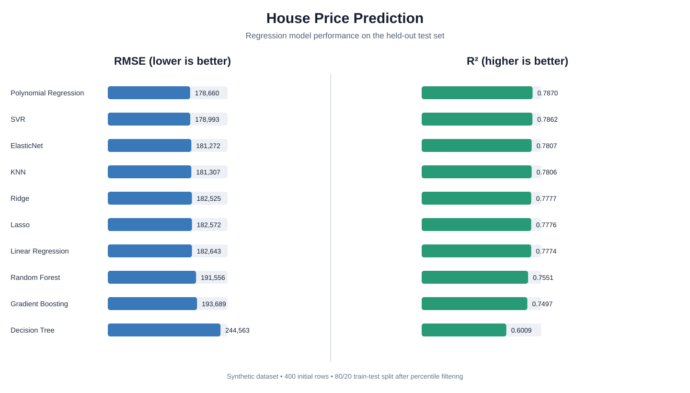

# EX-NO. 4(a) - Machine Learning Model: Linear Regression

## Aim
To predict house prices from property features, train multiple regression algorithms, and compare their performance using RMSE, MAE and R².

## Software Requirements
- Python 3.x
- NumPy
- Pandas
- Matplotlib
- Scikit-learn

## Dataset Description
A reproducible synthetic dataset is generated inside the Python program. It contains 400 initial records with the following columns:

| Feature | Description |
|---|---|
| `square_feet` | Built-up area of the house |
| `num_rooms` | Number of rooms |
| `age` | Age of the house in years |
| `distance_to_city(km)` | Distance from the city centre |
| `price` | House price, the target variable |

The generated price is based on the property features with added random noise. The random seed is fixed so that the same dataset and results can be reproduced. No CSV file, Google Drive mount or external dataset is required.

## Problem Statement
Build regression models that estimate house prices from the four property features. Evaluate the models on unseen test data and identify the model with the lowest RMSE.

## Procedure
1. Import NumPy, Pandas, Matplotlib and the required Scikit-learn classes.
2. Generate the synthetic house-price dataset using a fixed random seed.
3. Display the first five records, dataset dimensions and missing-value counts.
4. Remove extreme target values outside the 1st and 99th price percentiles.
5. Separate the input features (X) from the target variable (y).
6. Split the data into 80% training data and 20% testing data.
7. Standardize the input features by fitting `StandardScaler` on the training set only.
8. Train Linear Regression, Ridge, Lasso, ElasticNet, Polynomial Regression, Decision Tree, Random Forest, Gradient Boosting, SVR and KNN models.
9. Predict house prices for the test set using each trained model.
10. Calculate RMSE, MAE and R² for every model.
11. Sort the results by RMSE and identify the best-performing model.
12. Generate and save the model-comparison and actual-versus-predicted graphs.

## Regression Models
1. Linear Regression
2. Ridge Regression
3. Lasso Regression
4. ElasticNet Regression
5. Polynomial Regression (degree 2)
6. Decision Tree Regressor
7. Random Forest Regressor
8. Gradient Boosting Regressor
9. Support Vector Regressor (RBF kernel)
10. K-Nearest Neighbors Regressor

## Program

The complete program is also available as [`linear_regression.py`](linear_regression.py).

```python
import numpy as np
import pandas as pd
import matplotlib.pyplot as plt

from sklearn.model_selection import train_test_split
from sklearn.preprocessing import StandardScaler, PolynomialFeatures
from sklearn.linear_model import LinearRegression, Ridge, Lasso, ElasticNet
from sklearn.tree import DecisionTreeRegressor
from sklearn.ensemble import RandomForestRegressor, GradientBoostingRegressor
from sklearn.svm import SVR
from sklearn.neighbors import KNeighborsRegressor
from sklearn.metrics import mean_squared_error, mean_absolute_error, r2_score

# 1. Create a reproducible synthetic house-price dataset.
rng = np.random.default_rng(42)
n_samples = 400

square_feet = rng.integers(550, 3200, n_samples)
num_rooms = np.clip(
    np.rint(square_feet / 430 + rng.normal(0, 0.8, n_samples)), 1, 8
).astype(int)
age = rng.integers(0, 41, n_samples)
distance = np.round(rng.uniform(0.5, 35.0, n_samples), 2)

noise = rng.normal(0, 180000, n_samples)
price = (
    450000
    + square_feet * 260
    + num_rooms * 95000
    - age * 8500
    - distance * 12500
    + noise
)
price = np.maximum(price, 350000)

df = pd.DataFrame({
    "square_feet": square_feet,
    "num_rooms": num_rooms,
    "age": age,
    "distance_to_city(km)": distance,
    "price": np.round(price, 2)
})

print("FIRST FIVE RECORDS")
print(df.head().to_string(index=False))
print("\nDATASET SHAPE:", df.shape)
print("\nMISSING VALUES")
print(df.isnull().sum().to_string())

# 2. Remove extreme target values using the 1st and 99th percentiles.
lower_limit = df["price"].quantile(0.01)
upper_limit = df["price"].quantile(0.99)
df = df[df["price"].between(lower_limit, upper_limit)].copy()

# 3. Define input features and target; split into training and testing sets.
feature_names = [
    "square_feet",
    "num_rooms",
    "age",
    "distance_to_city(km)"
]
X = df[feature_names]
y = df["price"]

X_train, X_test, y_train, y_test = train_test_split(
    X, y, test_size=0.20, random_state=42
)

# Fit the scaler on training data only to prevent data leakage.
scaler = StandardScaler()
X_train_scaled = scaler.fit_transform(X_train)
X_test_scaled = scaler.transform(X_test)

print("\nTRAINING SET:", X_train.shape)
print("TESTING SET :", X_test.shape)

# 4. Define and train the regression models.
models = {
    "Linear Regression": LinearRegression(),
    "Ridge": Ridge(alpha=1.0),
    "Lasso": Lasso(alpha=1000.0, max_iter=20000),
    "ElasticNet": ElasticNet(alpha=0.1, l1_ratio=0.5, max_iter=20000),
    "Decision Tree": DecisionTreeRegressor(max_depth=8, random_state=42),
    "Random Forest": RandomForestRegressor(
        n_estimators=150, max_depth=12, random_state=42, n_jobs=-1
    ),
    "Gradient Boosting": GradientBoostingRegressor(
        n_estimators=150, learning_rate=0.05, max_depth=2, random_state=42
    ),
    "SVR": SVR(kernel="rbf", C=100000, gamma="scale", epsilon=50000),
    "KNN": KNeighborsRegressor(n_neighbors=7)
}

# Polynomial Regression: degree-2 feature expansion followed by Linear Regression.
poly = PolynomialFeatures(degree=2, include_bias=False)
X_train_poly = poly.fit_transform(X_train_scaled)
X_test_poly = poly.transform(X_test_scaled)

poly_model = LinearRegression()
poly_model.fit(X_train_poly, y_train)

predictions = {
    "Polynomial Regression": poly_model.predict(X_test_poly)
}

for name, model in models.items():
    model.fit(X_train_scaled, y_train)
    predictions[name] = model.predict(X_test_scaled)

# 5. Evaluate each model using RMSE, MAE and R-squared.
rows = []
for name, y_pred in predictions.items():
    rows.append({
        "Model": name,
        "RMSE": np.sqrt(mean_squared_error(y_test, y_pred)),
        "MAE": mean_absolute_error(y_test, y_pred),
        "R2": r2_score(y_test, y_pred)
    })

results = pd.DataFrame(rows).sort_values("RMSE").reset_index(drop=True)

print("\nMODEL PERFORMANCE")
print(results.to_string(
    index=False,
    formatters={
        "RMSE": "{:,.2f}".format,
        "MAE": "{:,.2f}".format,
        "R2": "{:.4f}".format
    }
))

best_model = results.iloc[0]["Model"]
print("\nBEST MODEL BY RMSE:", best_model)

# 6. Generate model-comparison graphs.
fig, axes = plt.subplots(1, 2, figsize=(16, 7))
rmse_order = results.sort_values("RMSE", ascending=True)

axes[0].barh(rmse_order["Model"], rmse_order["RMSE"])
axes[0].invert_yaxis()
axes[0].set_title("RMSE Comparison")
axes[0].set_xlabel("RMSE (lower is better)")
axes[0].grid(axis="x", alpha=0.25)

axes[1].barh(rmse_order["Model"], rmse_order["R2"])
axes[1].invert_yaxis()
axes[1].set_title("R-squared Comparison")
axes[1].set_xlabel("R-squared (higher is better)")
axes[1].grid(axis="x", alpha=0.25)

fig.suptitle("House Price Prediction: Regression Model Performance", fontsize=15)
fig.tight_layout()
fig.savefig("model_comparison.png", dpi=180, bbox_inches="tight")
fig.savefig("model_comparison.svg", bbox_inches="tight")
plt.close(fig)

# 7. Plot actual versus predicted prices for the best model.
best_prediction = predictions[best_model]
fig, ax = plt.subplots(figsize=(8, 6))
ax.scatter(y_test, best_prediction, alpha=0.7)
minimum = min(y_test.min(), best_prediction.min())
maximum = max(y_test.max(), best_prediction.max())
ax.plot([minimum, maximum], [minimum, maximum], "r--", linewidth=2)
ax.set_xlabel("Actual House Price")
ax.set_ylabel("Predicted House Price")
ax.set_title(f"Actual vs Predicted: {best_model}")
ax.grid(alpha=0.25)
fig.tight_layout()
fig.savefig("actual_vs_predicted.png", dpi=180, bbox_inches="tight")
fig.savefig("actual_vs_predicted.svg", bbox_inches="tight")
plt.close(fig)

print("\nOUTPUT IMAGES SAVED:")
print("model_comparison.png")
print("actual_vs_predicted.png")
print("\nRESULT: Regression models trained and evaluated successfully.")
```

## Output

```text
FIRST FIVE RECORDS
 square_feet  num_rooms  age  distance_to_city(km)      price
         786          2   39                 21.01  350000.00
        2600          6   20                 10.67 1335709.41
        2284          5   35                 23.39  994730.47
        1713          4   40                 29.35  678838.77
        1697          4   35                  1.13  934217.18

DATASET SHAPE: (400, 5)

MISSING VALUES
square_feet             0
num_rooms               0
age                     0
distance_to_city(km)    0
price                   0

TRAINING SET: (316, 4)
TESTING SET : (80, 4)

MODEL PERFORMANCE
                Model       RMSE        MAE     R2
Polynomial Regression 178,660.15 147,053.57 0.7870
                  SVR 178,992.64 144,782.15 0.7862
           ElasticNet 181,271.69 150,526.49 0.7807
                  KNN 181,307.00 147,480.67 0.7806
                Ridge 182,524.93 151,219.71 0.7777
                Lasso 182,572.18 151,305.55 0.7776
    Linear Regression 182,642.50 151,290.31 0.7774
        Random Forest 191,556.12 156,386.50 0.7551
    Gradient Boosting 193,688.76 159,333.11 0.7497
           Decision Tree 244,562.50 204,673.78 0.6009

BEST MODEL BY RMSE: Polynomial Regression

OUTPUT IMAGES SAVED:
model_comparison.png
actual_vs_predicted.png

RESULT: Regression models trained and evaluated successfully.
```

## Model Comparison



## Generated Output Files
- `model_comparison.png` - RMSE and R² comparison across all ten models.
- `actual_vs_predicted.png` - Actual versus predicted prices for the best model.
- `model_comparison.svg` - Repository image showing the model comparison.

## Result
The ten regression models were trained and evaluated successfully. Polynomial Regression achieved the lowest RMSE on the generated test set.
